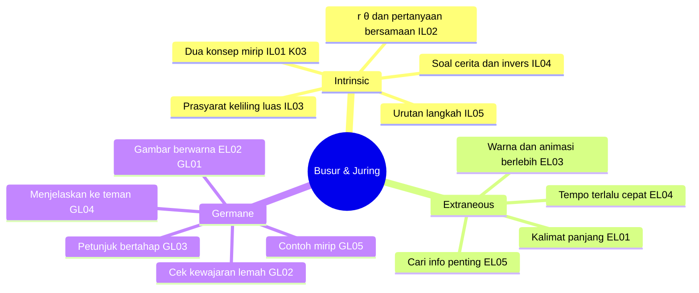

# Analysis — ADDIE Tahap Analisis

Dokumen ini merangkum hasil wawancara kebutuhan sebagai dasar keputusan desain. Sumber: *Kisi-kisi dan Pedoman
Wawancara Mendalam Cognitive Load* (instrumen penelitian pengembangan ADDIE).

> **Privasi:** informan hanya disebut dengan kode (S01, S02, …). Nama, foto, dan rekaman tidak disimpan di repositori ini.

## 1. Metode

| Komponen | Ketentuan |
|---|---|
| Desain | Wawancara mendalam semiterstruktur berbasis konstruk CLT (intrinsic, extraneous, germane) |
| Informan | Siswa yang **telah** mempelajari materi target (retrospektif); minimal 2 siswa dengan variasi kemampuan |
| Materi target | Panjang busur dan luas juring lingkaran (kelas VIII) |
| Durasi | 30–45 menit + tugas pemicu 10–15 menit |
| Artefak pemicu | Soal lingkaran dengan jari-jari 14 cm dan sudut pusat 90° (bukan butir pretest/posttest) |
| Pengodean | K = konteks/prasyarat, IL = intrinsic, EL = extraneous, GL = proses pemahaman (germane), DS = rekomendasi desain. Satu kutipan dapat memiliki lebih dari satu kode |
| Luaran | Peta sumber beban kognitif, kebutuhan desain, spesifikasi fitur, jejak keputusan |

**Status validasi instrumen:** pedoman wawancara **belum tervalidasi empiris**. Rencana validasi isi (2–3 ahli),
uji keterbacaan, dan triangulasi ada di [evaluation.md](evaluation.md#1-validasi-instrumen-analisis).

## 2. Profil informan

| Kode | Kelas | Tanggal | Durasi | Bukti pernah belajar | Catatan |
|---|---|---|---|---|---|
| S01 | IX | 8 November 2026 | ± 35 menit (daring/panggilan video) | Mempelajari materi di kelas VIII | Mengenali materi dasar, ingatan mulai berkurang |
| S02 | *(belum)* | — | — | — | Disarankan siswa dengan kemampuan berbeda dari S01 |

## 3. Kutipan terkode (S01)

| Kode pertanyaan | Kutipan (diringkas dari verbatim) | Kode | Interpretasi |
|---|---|---|---|
| K01 | "Saya belajar waktu kelas 8, tapi sekarang sudah agak lupa." | K | Pernah belajar; ingatan menurun → perlu penyegaran prasyarat |
| K02 | "Guru menjelaskan di papan tulis, memberi contoh soal. Saya mencatat dan mengerjakan soal." | K | Pola belajar: penjelasan → contoh → latihan |
| K03 | "Masih ingat tentang lingkaran, tapi bingung membedakan panjang busur dan luas juring. Rumusnya kadang tertukar." | K/IL | Dua konsep mirip tertukar |
| IL01 | "Sulit membedakan rumus panjang busur dan luas juring, karena bentuk rumusnya hampir sama." | IL | Kompleksitas & pembedaan konsep |
| IL02 | "Harus memperhatikan jari-jari, sudut pusat, dan apa yang ditanyakan." | IL | Interaktivitas unsur tinggi: r, θ, jenis pertanyaan |
| IL03 | "Harus paham keliling, luas lingkaran, dan bagian-bagian lingkaran." | IL/K | Prasyarat eksplisit |
| IL04 | "Mulai sulit ketika soal cerita, apalagi kalau harus mencari nilai yang belum diketahui." | IL | Kesulitan naik pada soal multi-langkah & invers |
| IL05 | "Salah memilih rumus atau memasukkan angka. Bingung mana yang harus dihitung dulu." | IL | Kesalahan pemilihan rumus & urutan langkah |
| EL01 | "Bingung kalau kalimat soalnya terlalu panjang dan sulit dimengerti." | EL | Redaksi soal membebani |
| EL02 | "Lebih mudah kalau ada gambar lingkaran, apalagi busur dan juringnya diberi warna berbeda." | EL/GL | Visual terintegrasi & kode warna membantu |
| EL03 | "Kalau terlalu banyak warna dan animasi, saya malah kurang fokus." | EL | Tampilan berlebihan mengalihkan perhatian |
| EL04 | "Penjelasan terlalu cepat membuat saya tertinggal, perlu diulang." | EL | Butuh kontrol tempo & pengulangan |
| EL05 | "Kesulitan mencari informasi penting dan menentukan apa yang ditanyakan." | EL | Butuh bantuan mengenali info relevan |
| GL01 | "Lebih paham kalau guru memberi gambar lingkaran dan contoh soal langsung." | GL | Gambar + contoh konkret membangun pemahaman |
| GL02 | "Menghitung ulang, tapi kadang belum yakin apakah rumusnya sudah benar." | GL | Pemeriksaan masih prosedural; perlu refleksi pemilihan rumus |
| GL03 | "Lebih suka diberi petunjuk sedikit demi sedikit, jangan langsung jawabannya." | GL | Petunjuk bertingkat |
| GL04 | "Saat menjelaskan kepada teman, saya jadi lebih paham juga." | GL | Self-explanation memperkuat pemahaman |
| GL05 | "Kalau ada contoh soal yang mirip, lebih mudah mengerjakan soal baru." | GL | Contoh sejenis mendukung transfer |
| DS01 | "Ingin ada gambar lingkaran, rumus, contoh soal, dan penjelasan cara mengerjakannya." | DS | Visual + rumus + contoh terurai |
| DS02 | "Penjelasan rumus dan contoh soal perlahan, setelah itu baru latihan sendiri." | DS | Bertahap, lalu latihan mandiri |
| DS03 | "Jangan terlalu banyak tulisan, warna, dan animasi yang tidak penting." | DS | Tampilan sederhana, fokus |

## 4. Peta sumber beban kognitif

### Implikasi per dimensi

| Dimensi | Strategi desain | Fitur (lihat [prd.md](prd.md#4-matriks-keterlacakan-temuan--kebutuhan--fitur)) |
|---|---|---|
| Intrinsic — **kelola** (tidak dihilangkan) | Pre-training prasyarat, kontras eksplisit, segmentasi langkah, urutan sederhana → kompleks | F01, F02, F03, F04 |
| Extraneous — **kurangi** | Kalimat pendek, signaling, contiguity, coherence, learner-paced | F05, F06, F07, F08 |
| Germane — **dorong** | Worked example, fading, self-explanation, variasi konteks, refleksi kewajaran | F09, F10, F11, F12 |

## 5. Daftar kebutuhan desain

1. Penyegaran prasyarat (bagian lingkaran, keliling, luas) sebelum materi inti.
2. Pembeda eksplisit busur (panjang, cm) vs juring (luas, cm²) dengan kode warna konsisten.
3. Langkah penyelesaian dipecah satu per layar, dimulai dari "apa yang ditanya".
4. Soal cerita disajikan ringkas dan dapat ditandai.
5. Tampilan minimal: sedikit teks, sedikit warna, tanpa animasi yang tidak bermakna.
6. Siswa mengatur tempo sendiri dan dapat mengulang.
7. Petunjuk bertingkat, tidak langsung memberi jawaban, dan memudar.
8. Contoh terurai → soal mirip → soal dengan konteks berbeda.
9. Ajakan memeriksa kewajaran jawaban dan menjelaskan alasan.

## 6. Keterbatasan

- Baru **satu informan**; temuan belum dapat digeneralisasi ke seluruh siswa SMP.
- Wawancara retrospektif rentan bias ingatan (K01: "sudah agak lupa"); dipisahkan dari respons tugas pemicu.
- Tidak menghitung reliabilitas internal dari dua informan (sesuai pedoman bagian I).
- Faktor afektif (cemas, motivasi) dicatat terpisah dan tidak otomatis dikodekan sebagai jenis beban kognitif.

## 7. Placeholder informan berikutnya

| Kode pertanyaan | Kutipan S02 | Kode | Sama/berbeda dengan S01 | Implikasi |
|---|---|---|---|---|
| K01 | | | | |
| … | | | | |

Jika temuan S01 dan S02 berbeda, dokumentasikan variasinya dan catat dampaknya di [decision-log.md](decision-log.md).
