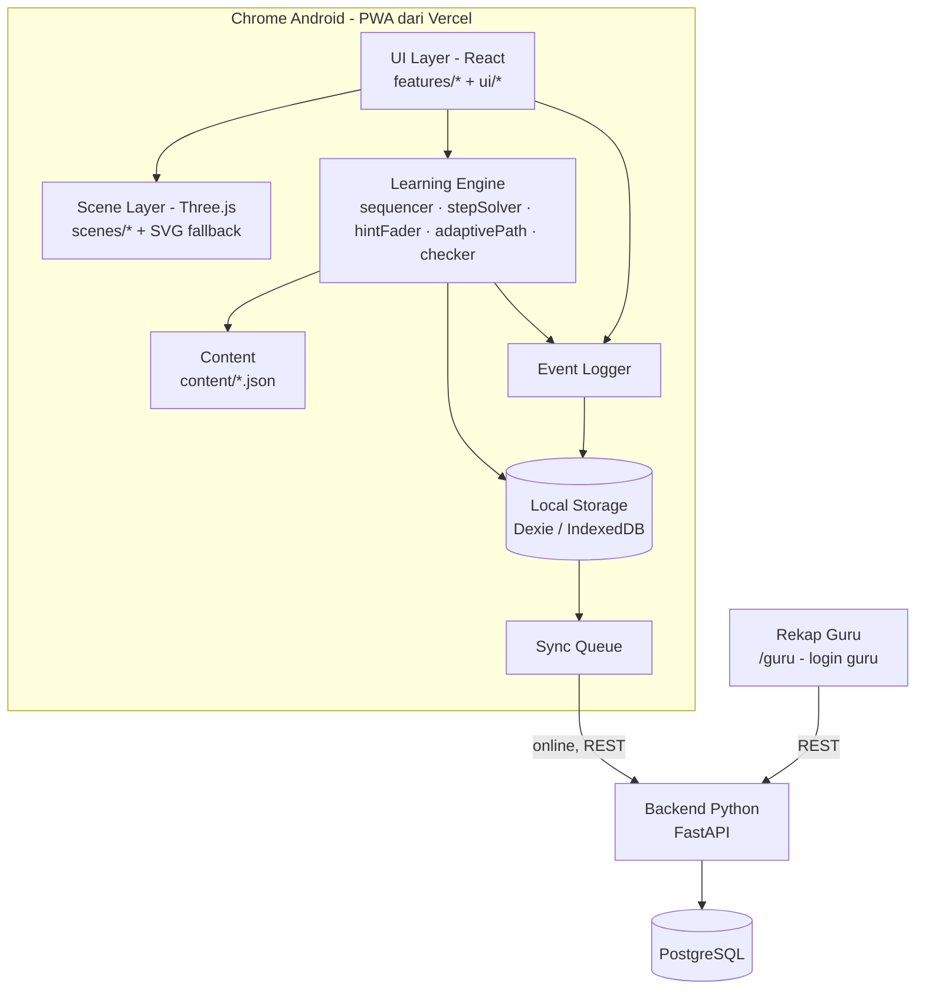
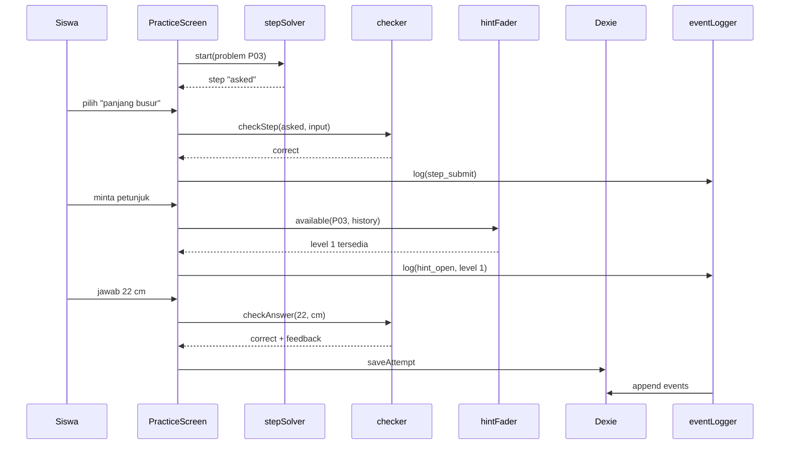

# Architecture — Literasy: Busur & Juring

## 1. Ringkasan

**Progressive Web App** (React + **JavaScript** + Vite + `vite-plugin-pwa`) yang di-hosting di **Vercel** dan dibuka
siswa melalui Chrome Android di kelas. Ilustrasi 3D memakai **Three.js** dalam modul terisolasi dengan fallback SVG.
Data belajar dikirim ke **backend Python FastAPI** yang menyimpan ke **PostgreSQL**, dengan **buffer IndexedDB**
(Dexie) agar tidak hilang saat koneksi putus. Guru memiliki halaman **rekap** terpisah.

> **Revisi ADR-017/018 (v0.2.0):** hanya Python & JavaScript. Penyebutan "TypeScript", `.ts`, "Supabase RLS", atau
> "RPC Supabase" di bawah ini dibaca sebagai: file `.js`/`.jsx`, otorisasi di endpoint FastAPI, dan endpoint REST
> FastAPI ([api.md](api.md#4-backend-fastapi--postgresql)). Kode aktual: `frontend/src/…` dan `backend/app/…`.

Alasan pemilihan dicatat di [decision-log.md](decision-log.md) (ADR-001 s.d. ADR-004, ADR-013 s.d. ADR-016).

## 2. Diagram lapisan



Aturan dependensi: `ui/features → engine → (content, data)`; `scenes` hanya dipanggil oleh `features` dan tidak
mengetahui engine; `engine` adalah TypeScript murni (tanpa React) agar mudah diuji.

## 3. Struktur modul

```
src/
├── app/                 # routing, provider, bootstrapping
│   ├── App.tsx
│   └── routes.tsx
├── content/             # data, bukan kode
│   ├── lessons.json     # kartu konsep C1–C6, remedial
│   ├── diagnostic.json  # D1–D6
│   ├── examples.json    # WE1–WE6
│   ├── problems.json    # P01–P18
│   ├── reflections.json # SE1–SE5
│   └── sequence.json    # urutan bagian (content.md §8)
├── engine/
│   ├── types.ts         # tipe Problem, Step, Attempt (lihat api.md)
│   ├── math.ts          # arcLength, sectorArea, inverse, pickPi, round
│   ├── checker.ts       # validasi jawaban, toleransi, deteksi miskonsepsi
│   ├── stepSolver.ts    # state machine 6 langkah
│   ├── hintFader.ts     # aturan pemudaran petunjuk
│   ├── adaptivePath.ts  # diagnostik → remedial / lanjut
│   └── sequencer.ts     # item berikutnya berdasarkan progres
├── scenes/
│   ├── core/            # createRenderer, renderOnDemand, dispose, webglSupport
│   ├── CircleSectorScene.ts
│   ├── SectorLiftScene.ts
│   ├── ArcUnrollScene.ts
│   ├── context/         # pizza, clock, fan, park, ferrisWheel, sprinkler
│   ├── svg/             # fallback 2D dengan API yang sama
│   └── SceneView.tsx    # wrapper React: mount/unmount, pilih 3D atau SVG
├── features/
│   ├── auth/            # masuk dengan kode siswa
│   ├── diagnostic/
│   ├── explore/         # eksplorasi 3D + slider
│   ├── lesson/          # kartu konsep, modul kontras
│   ├── example/         # contoh terurai
│   ├── practice/        # Step Solver, latihan mandiri, hint sheet
│   ├── literacy/        # soal cerita, Tandai Info, Cek Kewajaran
│   ├── reflection/      # Jelaskan ke Teman
│   ├── effort/          # skala Paas
│   ├── progress/        # beranda/jalur, ringkasan
│   └── teacher/         # rekap guru (route /guru, lazy-loaded, tidak masuk bundel siswa)
├── data/
│   ├── db.ts            # skema Dexie
│   ├── repositories.ts  # progress, attempts, events
│   └── export.ts        # CSV
├── sync/
│   ├── supabaseClient.ts
│   └── syncQueue.ts
└── ui/                  # Button, Card, Slider, Formula (KaTeX), tokens.css
```

## 4. Alur data: satu soal latihan



## 5. Learning engine

| Komponen | Tanggung jawab | Aturan kunci |
|---|---|---|
| `math.ts` | Rumus murni | `arcLength(r, θ, π)`, `sectorArea(r, θ, π)`, `thetaFromArc`, `radiusFromSector`, `pickPi(r)` |
| `checker.ts` | Bandingkan jawaban | Toleransi relatif 0,01; normalisasi koma/titik; cek satuan; cocokkan pola miskonsepsi |
| `stepSolver.ts` | State machine: `asked → given → fraction → formula → compute → check → done` | Tidak bisa melompat langkah pada mode terbimbing; dapat kembali ke langkah sebelumnya |
| `hintFader.ts` | Jumlah tingkat petunjuk yang tersedia | Mulai 3; −1 setelah 2 soal berturut-turut benar tanpa petunjuk; minimum 1 pada latihan mandiri; +1 bila salah 2× pada soal yang sama |
| `adaptivePath.ts` | Diagnostik → jalur | Skor < 4 → remedial untuk butir salah; remedial selesai → lanjut |
| `sequencer.ts` | Menentukan item berikutnya | Mengikuti `sequence.json`; tidak ada pengacakan pada uji coba (konsistensi penelitian) |

## 6. Lapisan 3D

- Satu `WebGLRenderer` dipakai bergantian (singleton) untuk menghemat memori.
- **Render-on-demand**: render hanya saat slider/kamera berubah; tidak ada loop `requestAnimationFrame` permanen.
- `devicePixelRatio` dibatasi `min(window.devicePixelRatio, 2)`.
- Setiap scene mengimplementasikan `dispose()` (geometry, material, texture, controls).
- `webglSupport()` + pemantau FPS → fallback `svg/*` dengan antarmuka `SceneHandle` yang sama ([api.md](api.md#3-scene-api)).
- Aset konteks low-poly (glTF ≤ 200 KB per model, Draco opsional) disajikan dari Vercel, dimuat saat scene dibuka
  dan di-cache service worker.
- Target HP kelas menengah memungkinkan antialias aktif dan ≥ 45 FPS; fallback SVG tetap wajib.

## 7. Penyimpanan & sinkronisasi

Siswa selalu online saat pemakaian (ADR-003 revisi), tetapi Wi-Fi kelas bisa putus sesaat, sehingga tetap memakai
**write-behind buffer**.

**Dexie (lokal) — tabel**
`profile` (kode siswa, kode kelas), `progress` (per bagian), `attempts`, `events`, `effortRatings`, `reflections`,
`syncQueue`.

**Strategi sinkronisasi**
1. Setiap tulis masuk Dexie dan `syncQueue` (id UUID, idempoten).
2. Antrean dikirim segera (debounce 2 s) dalam batch ≤ 100 baris via `upsert` (konflik pada `id` diabaikan).
3. Gagal/offline (`navigator.onLine`, event `online`) → backoff 5 s, 30 s, 2 m; indikator kecil "Menyimpan…" muncul
   hanya bila antrean tertahan > 30 s.
4. Saat masuk di HP lain, progres diambil dari server (`get_my_progress`) sehingga siswa dapat berganti perangkat.
5. Siswa hanya dapat membaca progres kodenya sendiri melalui RPC; tidak ada akses data siswa lain.

**Service worker (`vite-plugin-pwa`, Workbox)**
- Precache: shell aplikasi, JS/CSS, JSON konten, font, ikon.
- Runtime cache (CacheFirst): model glTF konteks, dimuat saat scene dibuka.
- Strategi update: `prompt` — tampil "Versi baru tersedia, muat ulang?" di beranda, tidak di tengah soal.

## 8. Event logging (untuk evaluasi)

| Event | Payload utama |
|---|---|
| `section_start` / `section_end` | sectionId, durasi |
| `step_submit` | problemId, step, input, correct |
| `hint_open` | problemId, level |
| `answer_submit` | problemId, value, unit, correct, misconceptionId |
| `sanity_check` | problemId, decision (`kirim`/`periksa`) , changedAfter |
| `highlight` | problemId, tokens yang ditandai |
| `replay` | screenId |
| `scene_interact` | sceneId, θ, r |
| `effort_rating` | sectionId, nilai 1–9 |
| `self_explain` | promptId, choice/text, score |

Event tidak memuat nama atau data identitas lain.

## 9. Android (PWA)

| Aspek | Ketentuan |
|---|---|
| Target | Chrome Android terbaru di Android 11+, HP kelas menengah (RAM 4–6 GB); diuji juga Samsung Internet |
| Manifest | `name`, `short_name: "Busur & Juring"`, `display: standalone`, `orientation: portrait`, `theme_color`, ikon 192/512 + maskable |
| Instalasi | Prompt "Tambahkan ke layar utama" ditampilkan di beranda setelah sesi pertama (bukan saat login) |
| Hosting | Vercel (HTTPS otomatis); `vercel.json` rewrite SPA ke `index.html`; header cache immutable untuk aset ber-hash |
| Ukuran | Unduhan awal ≤ 3 MB gzip; Three.js & scene di-*code-split*, dimuat saat Eksplorasi dibuka |
| Fitur web | Web Share API untuk ekspor CSV (fallback unduh file); `screen.orientation` tidak dipaksa |
| Capacitor | Ditunda (P2). Arsitektur tetap kompatibel: tidak memakai API yang hanya ada di browser desktop |

### Lingkungan Vercel
| Environment | Branch | Supabase |
|---|---|---|
| Production | `main` | proyek produksi (data uji coba) |
| Preview | branch lain/PR | proyek staging (data dummy) |

## 10. Keamanan & privasi

- Kunci Supabase *anon* hanya mengizinkan `insert` ke tabel penelitian (RLS) dan RPC terbatas; tidak ada `select`
  langsung.
- Guru login dengan Supabase Auth; hanya dapat membaca rekap kelas yang terdaftar atas namanya (`teacher_classes`).
- Ekspor/analisis oleh peneliti melalui role terpisah (service role di luar aplikasi).
- Rincian di [privacy.md](privacy.md).

## 11. Build & CI

```
lint (eslint) → typecheck (tsc --noEmit) → unit test (vitest) → content:check → build (vite) → Vercel deploy
```
Vercel membuat *preview URL* untuk setiap branch/PR — dipakai untuk validasi ahli tanpa mengganggu produksi.
Lighthouse CI (opsional) memeriksa skor PWA & performa.
