# Design — Desain Instruksional, Antarmuka, dan Ilustrasi 3D

Dokumen tahap ADDIE *Design*. Semua keputusan merujuk kode temuan di [analysis.md](analysis.md) dan istilah di
[glossary.md](glossary.md).

## 1. Prinsip desain berbasis Cognitive Load Theory

| Prinsip | Penerapan di aplikasi | Kode |
|---|---|---|
| **Pre-training** | Diagnostik & remedial bagian lingkaran, keliling, luas sebelum materi inti | IL03, K01 |
| **Segmenting** | Satu ide per layar; Step Solver satu langkah per layar | IL02, IL05, DS02 |
| **Signaling** | Kode warna tetap (busur oranye, juring biru, sudut hijau); kata kunci ditebalkan | IL01, EL02 |
| **Spatial contiguity** | Label menempel di gambar; teks penjelas tepat di bawah ilustrasi pada layar yang sama | EL02 |
| **Coherence** | Tanpa ilustrasi/animasi dekoratif, tanpa latar bergambar, tanpa suara latar | EL03, DS03 |
| **Learner pacing** | Tidak ada auto-play/timer; tombol Kembali & Ulangi selalu tersedia | EL04 |
| **Worked example** | Contoh terurai lengkap sebelum latihan | GL01, GL05, DS01 |
| **Completion & fading** | Soal melengkapi → mandiri; petunjuk berkurang | IL04, GL03 |
| **Self-explanation** | "Jelaskan ke Teman" setelah contoh dan setelah soal tertentu | GL04 |
| **Variability** | Konteks soal bervariasi setelah pola dikuasai | GL05 |
| **Monitoring** | Cek Kewajaran & cek satuan sebelum mengirim jawaban | GL02 |

### Aturan praktis (wajib dipatuhi)

1. ≤ **40 kata** teks per kartu; ≤ **2 kalimat** per paragraf.
2. ≤ **3 warna semantik** dalam satu layar, selain warna netral.
3. Animasi hanya untuk menunjukkan **perubahan matematis** (sudut membesar, juring terangkat), durasi ≤ 300 ms, dan
   dapat dimatikan (`prefers-reduced-motion` dihormati).
4. Satu tombol aksi utama per layar.
5. Gambar dan teks yang saling menjelaskan **tidak boleh** dipisah layar/scroll.

## 2. Design tokens

### Warna (aman buta warna, palet Okabe–Ito)

| Token | Nilai terang | Nilai gelap | Makna |
|---|---|---|---|
| `--c-arc` | `#E69F00` | `#F0B429` | Busur / panjang busur |
| `--c-sector` | `#0072B2` | `#56B4E9` | Juring / luas juring |
| `--c-angle` | `#009E73` | `#33C49A` | Sudut pusat / pecahan θ/360 |
| `--c-ink` | `#1F2933` | `#E4E7EB` | Teks utama, jari-jari, garis lingkaran |
| `--c-muted` | `#616E7C` | `#9AA5B1` | Teks sekunder |
| `--c-surface` | `#FFFFFF` | `#121417` | Latar |
| `--c-surface-2` | `#F5F7FA` | `#1E2126` | Kartu |
| `--c-correct` | `#1A7F37` | `#3FB950` | Umpan balik benar (ikon ✓ + teks, tidak hanya warna) |
| `--c-retry` | `#B35900` | `#DB8A3A` | Umpan balik "coba lagi" (tidak memakai merah menakutkan) |

> Warna benar/coba lagi **selalu** disertai ikon dan teks agar tidak bergantung pada warna.

### Tipografi & ukuran

| Token | Nilai |
|---|---|
| Font | Inter / sistem sans-serif; angka tabular untuk hasil hitung |
| Ukuran teks dasar | 16sp; judul kartu 20sp; rumus 20sp |
| Rumus | Dirender KaTeX, ukuran sama dengan teks judul |
| Target sentuh | ≥ 48 × 48 dp |
| Jarak | Skala 4/8/12/16/24/32 dp |
| Sudut kartu | 12 dp |
| Lebar konten | 100% minus margin 16 dp; maks. 560 dp pada tablet |

## 3. Peta layar & alur

```mermaid
flowchart LR
  A[Masuk: kode siswa] --> B[Beranda / Jalur]
  B --> C[Diagnostik 6 soal]
  C -->|skor < 4| R[Remedial prasyarat]
  R --> D
  C -->|skor ≥ 4| D[Eksplorasi 3D]
  D --> E[Kartu Konsep: Busur]
  E --> F[Kartu Konsep: Juring]
  F --> G[Modul Kontras]
  G --> H[Contoh Terurai x2]
  H --> I[Latihan Terbimbing - Step Solver]
  I --> J[Latihan Mandiri]
  J --> K[Soal Literasi berkonteks]
  K --> L[Refleksi: Jelaskan ke Teman]
  L --> M[Skala Usaha + Ringkasan]
```



Setiap bagian (D–L) diakhiri skala usaha mental 1–9 (F14).

## 4. Wireframe (ASCII, layar 360 × 760 dp)

### 4.1 Beranda / Jalur
```
┌──────────────────────────────┐
│ Halo, S01            ⚙       │
│                              │
│ Busur & Juring               │
│ ━━━━━━━━━━░░░░░░  4/8        │
│                              │
│ ✓ Cek Prasyarat              │
│ ✓ Eksplorasi                 │
│ ✓ Konsep Busur               │
│ ● Konsep Juring   ← lanjut   │
│ ○ Bedakan Busur & Juring     │
│ ○ Contoh Soal                │
│ ○ Latihan                    │
│ ○ Soal Kehidupan Nyata       │
│                              │
│ [      Lanjutkan Belajar   ] │
└──────────────────────────────┘
```

### 4.2 Eksplorasi 3D
```
┌──────────────────────────────┐
│ ← Eksplorasi        1/3   ↻  │
│ ┌──────────────────────────┐ │
│ │       (scene 3D)         │ │
│ │     ╭───oranye───╮       │ │
│ │    │  ▲biru      │       │ │
│ │    │ O──r=14──   │       │ │
│ │     ╰───────────╯        │ │
│ │  θ=90°  (hijau)          │ │
│ └──────────────────────────┘ │
│ Sudut pusat  ●━━━━○────  90° │
│ Jari-jari    ●━━○──────  14  │
│                              │
│ 90° / 360° = ¼ lingkaran     │
│ Busur = ¼ keliling = 22 cm   │
│ Juring = ¼ luas = 154 cm²    │
│                              │
│ [ Tampilkan: Busur | Juring ]│
│ [ ← Kembali ]  [ Lanjut → ]  │
└──────────────────────────────┘
```
- Mode tampilan **Busur** menyembunyikan juring (dan sebaliknya) untuk mengurangi elemen simultan.
- Label angka diperbarui langsung saat slider digeser.

### 4.3 Kartu Konsep (contoh: Busur)
```
┌──────────────────────────────┐
│ ← Konsep Busur       2/4  ↺  │
│ ┌──────────────────────────┐ │
│ │ (gambar 2D: busur oranye │ │
│ │  dengan label "busur")   │ │
│ └──────────────────────────┘ │
│ Busur adalah **bagian dari   │
│ keliling**. Karena itu       │
│ panjang busur pakai keliling.│
│                              │
│   Panjang busur =            │
│      θ/360° × 2πr            │
│   satuan: cm                 │
│                              │
│ [ ← Kembali ]  [ Lanjut → ]  │
└──────────────────────────────┘
```
`↺` = ulangi kartu dari awal (EL04).

### 4.4 Modul Kontras Busur–Juring
```
┌──────────────────────────────┐
│ ← Bedakan                    │
│ ┌────────────┬─────────────┐ │
│ │  BUSUR     │  JURING     │ │
│ │ (garis     │ (daerah     │ │
│ │  oranye)   │  biru)      │ │
│ │ bagian dari│ bagian dari │ │
│ │ KELILING   │ LUAS        │ │
│ │ θ/360×2πr  │ θ/360×πr²   │ │
│ │ cm         │ cm²         │ │
│ └────────────┴─────────────┘ │
│ Yang sama: θ/360°            │
│ Yang beda: keliling vs luas  │
│                              │
│ Cek cepat: "Panjang tali     │
│ pagar melengkung" itu…       │
│ [ Busur ]      [ Juring ]    │
└──────────────────────────────┘
```

### 4.5 Step Solver (Latihan Terbimbing)
```
┌──────────────────────────────┐
│ ← Latihan 2/5      Langkah 3/6│
│ ┌──────────────────────────┐ │
│ │ (gambar kecil soal,      │ │
│ │  r & θ dilabeli)         │ │
│ └──────────────────────────┘ │
│ ① Ditanya: panjang busur ✓   │
│ ② Diketahui: r=14, θ=90° ✓   │
│ ③ Pecahan sudut:             │
│    θ/360° = [ 90 ] / 360     │
│           = [    ]           │
│                              │
│ [💡 Petunjuk (3)]  [ Cek ]   │
└──────────────────────────────┘
```
- Langkah yang selesai menyusut menjadi satu baris (tetap terlihat sebagai jejak, tidak hilang).

### 4.6 Lembar Petunjuk
```
┌──────────────────────────────┐
│ Petunjuk 1 dari 3            │
│ Satu putaran penuh = 360°.   │
│ Berapa bagian 90° dari 360°? │
│                              │
│ [ Tutup ]  [ Petunjuk 2 → ]  │
└──────────────────────────────┘
```

### 4.7 Soal Cerita dengan "Tandai Info Penting"
```
┌──────────────────────────────┐
│ ← Soal Kehidupan Nyata       │
│ ① Taman berbentuk juring.    │
│ ② Jari-jarinya [14 m].       │
│ ③ Sudut pusatnya [90°].      │
│ ④ Tepi taman akan dipagari.  │
│ ⑤ Berapa [panjang pagar]?    │
│   (ketuk kata/angka penting) │
│                              │
│ Yang kamu tandai:            │
│ r = 14 m · θ = 90° ·         │
│ ditanya: panjang pagar       │
│ [ Lanjut ke langkah → ]      │
└──────────────────────────────┘
```

### 4.8 Cek Kewajaran (sebelum kirim)
```
┌──────────────────────────────┐
│ Jawabanmu: 154 cm            │
│ Satuan: cm   ← yang ditanya  │
│              panjang? ✓      │
│ 90° = ¼ lingkaran.           │
│ ¼ dari keliling 88 cm ≈ 22.  │
│ Apakah 154 masuk akal?       │
│ [ Ya, kirim ] [ Periksa lagi]│
└──────────────────────────────┘
```

### 4.9 Refleksi "Jelaskan ke Teman"
```
┌──────────────────────────────┐
│ Temanmu bertanya:            │
│ "Kenapa pakai keliling,      │
│  bukan luas?"                │
│ ○ Karena busur itu garis,    │
│   bagian dari keliling       │
│ ○ Karena angkanya lebih kecil│
│ ○ Karena sudutnya 90°        │
│ ✎ Tulis dengan kata-katamu…  │
│ [ Kirim ]                    │
└──────────────────────────────┘
```

### 4.10 Skala Usaha Mental (Paas)
```
┌──────────────────────────────┐
│ Seberapa besar usaha         │
│ pikiranmu di bagian tadi?    │
│ 1 2 3 4 5 6 7 8 9            │
│ sangat      sangat           │
│ ringan      berat            │
│ [ Simpan ]                   │
└──────────────────────────────┘
```

## 5. Umpan balik

| Situasi | Contoh umpan balik | Prinsip |
|---|---|---|
| Benar | "✓ Tepat. Busur 90° = ¼ keliling." | Umpan balik elaboratif singkat |
| Salah rumus (memakai luas untuk busur) | "Satuan jawabanmu cm². Yang ditanya **panjang** busur. Busur memakai **keliling**." | Spesifik pada miskonsepsi IL01 |
| Salah pecahan | "Periksa lagi θ/360°. 90 dibagi 360 = …" | Menunjuk langkah, bukan jawaban |
| Salah hitung | "Rumusmu sudah benar. Cek perkalianmu." | Memisahkan konsep vs komputasi (IL05) |
| Salah 2× | Tawarkan petunjuk berikutnya | Fading terbalik bila perlu |

Umpan balik tidak memakai kata "salah!" berhuruf besar, suara keras, atau getar.

## 6. Spesifikasi ilustrasi 3D (Three.js)

### 6.1 Peran 3D
3D dipakai **hanya** bila menambah pemahaman relasi sudut–bagian lingkaran (EL02, GL01) dan **tidak** sebagai hiasan
(EL03). Layar konsep & Step Solver memakai SVG 2D agar ringan.

### 6.2 Scene
| Scene | Isi | Interaksi | Fitur |
|---|---|---|---|
| `CircleSectorScene` | Cakram tipis (tinggi 0,1 r) abu muda; busur = tabung oranye (TubeGeometry di sepanjang busur); juring = ekstrusi biru (ExtrudeGeometry dari Shape juring), sedikit lebih tinggi dari cakram; dua jari-jari garis gelap; busur sudut hijau di pusat | Slider θ (0–360°, langkah 1°; snap ke 30/45/60/90/120/180), slider r; putar & zoom; tombol reset; toggle Busur/Juring/Keduanya | F01, F06 |
| `SectorLiftScene` | Juring "terangkat" dari cakram lalu disusun berdampingan: 4 juring 90° membentuk lingkaran utuh → memperlihatkan θ/360 | Tombol "Angkat juring", "Susun" (transisi 300 ms) | F01, IL01 |
| `ArcUnrollScene` | Busur oranye "diluruskan" menjadi garis lurus di samping penggaris → panjang busur adalah panjang | Tombol "Luruskan busur" | F01, IL01 |
| `ContextScene` | Model low-poly: pizza (juring = potongan), jam dinding (jarum menit menyapu juring), kipas angin, taman, bianglala, penyiram | Statis + satu slider relevan; label menempel | F12, literasi |

### 6.3 Aturan visual 3D
- Pencahayaan: 1 `HemisphereLight` + 1 `DirectionalLight`; tanpa bayangan dinamis (performa).
- Material: `MeshStandardMaterial` warna token; tanpa tekstur kecuali konteks (tekstur ≤ 256 px).
- Kamera: perspektif, default sudut 35° dari atas agar juring dan busur sama-sama terlihat; tombol "Tampak atas"
  untuk tampilan 2D-like.
- Label: HTML overlay (CSS2DRenderer) agar tajam dan mengikuti token tipografi.
- Tidak ada rotasi otomatis, partikel, atau efek kilau.
- Fallback: bila WebGL tidak tersedia/FPS < 20 selama 3 detik → ganti komponen SVG dengan interaksi slider yang sama.

## 7. Aksesibilitas
- Semua kontrol berlabel untuk TalkBack; slider dapat diatur dengan tombol −/+.
- Kontras teks ≥ 4.5:1; informasi tidak hanya lewat warna (busur juga bergaris tebal, juring berpola arsir opsional).
- Mendukung ukuran font sistem hingga 130% tanpa teks terpotong.
- Mode gelap mengikuti sistem.

## 8. Pemetaan literasi matematis

| Proses PISA | Indikator pada materi busur & juring | Bentuk aktivitas di aplikasi |
|---|---|---|
| **Formulate** (merumuskan) | Mengenali bagian lingkaran dalam konteks (pagar melengkung = busur, potongan pizza = juring); menentukan data & yang ditanya | Tandai Info Penting; pilih "busur atau juring?"; langkah ① ② Step Solver |
| **Employ** (menggunakan) | Menghitung θ/360, menerapkan rumus, menyelesaikan soal invers | Langkah ③–⑤ Step Solver; latihan mandiri |
| **Interpret / Evaluate** (menafsirkan) | Menilai kewajaran hasil, membandingkan dua pilihan, mengambil keputusan dalam konteks | Cek Kewajaran; soal perbandingan (pizza mana lebih besar?); evaluasi pernyataan teman |

Tingkat soal mengikuti [content.md](content.md#4-bank-soal): L1 langsung → L2 cerita sederhana → L3 invers/multi-langkah
→ L4 literasi (keputusan dalam konteks).
